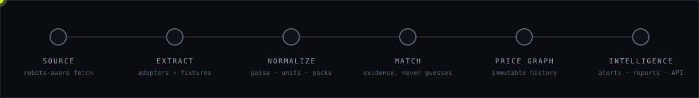
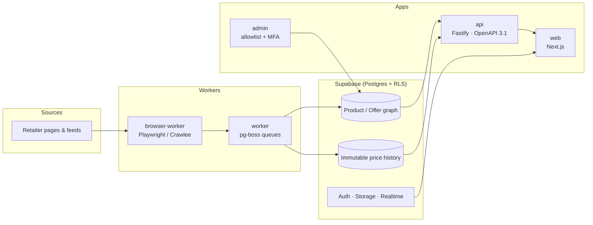

<div align="center">



<br/>

**The verified, historical graph of products, merchants and prices.**
Honest price comparison for shoppers. Market intelligence for brands. Resilient extraction for developers. One platform.

<br/>


[Quick start](#-quick-start) · [The idea](#-the-idea) · [Products](#-three-products-one-platform) · [Trust](#-trust-is-the-product) · [Architecture](#-architecture) · [Status](#-honest-status) · [Docs](#-documentation)

</div>


## ◈ The idea

The web is full of prices, and most of them lie by omission: stale numbers, fake "sales", and two different products treated as one.

Scrappy treats the web as **data to be resolved**, not pages to be scraped. Every number it shows can answer three questions: *where did this come from, how old is it, and how sure are we?*

<div align="center">

</div>

Each stage is isolated, versioned and observable. A broken retailer adapter degrades one source. It never takes the platform down.


## ◈ Three products, one platform

| | **Compare** | **Intelligence** | **Extract** |
|---|---|---|---|
| **For** | Shoppers | Sellers, brands, pricing teams | Developers, analysts |
| **Promise** | *Know if it's actually a deal.* | *See your market move before it moves your sales.* | *Structured web data, one API call.* |
| **Core** | Search, offers, step-line price history, watchlist, alerts | Competitor gaps, market view, rules, scheduled reports | Visual builder, selectors with fallbacks, runs, datasets, webhooks |
| **Honest by design** | Deal score with a written reason; fake-discount (MRP inflation) flag | Every chart answers a named business question | Human-readable diagnostics when a selector breaks |

All three read from the same **product / merchant / offer graph**, so a match confirmed for a shopper improves a seller's market view too.


## ◈ Trust is the product

<div align="center">

</div>

> **A false match is worse than a missed match.** Scrappy never silently merges uncertain products.

- **Evidence, not vibes.** Every match stores its features (identifiers, model, storage, pack size, price plausibility) and any conflicts.
- **Hard conflicts always win.** 128GB vs 256GB, 1-pack vs 2-pack, new vs refurbished, accessory vs device: never auto-merged.
- **Possible matches stay visible but separate.** Shown with a dashed *Possible match* badge and excluded from price comparison math by default.
- **Provenance everywhere.** Source, fetch time, freshness, extraction method and confidence travel with each price.
- **Stale prices never get deal badges.** Past 24 hours, a price is dimmed and labelled.
- **Synthetic data is labelled.** Demo rows carry an `is_synthetic` flag and a visible badge.


## ◈ Design: a data instrument

Precise, calm, fast. Hairline borders instead of floating cards, tabular mono numerals for every price, and one **signal** colour (`#C6F135`) used only for what is live or actionable.

| Token | Value | Use |
|---|---|---|
| `ink-950` | `#0A0C0F` | Canvas (dark) |
| `paper-50` | `#FAF9F6` | Canvas (light) |
| `signal-400` | `#C6F135` | Live, fresh, actionable (under 5% of any screen) |
| `price-down` / `price-up` | `#2FBF8A` / `#F2685B` | Always paired with an arrow, never colour alone |
| `uncertain` | `#9A7BFF` | Possible matches |

Motion explains and never decorates: price digits roll, lists reorder smoothly, the logo converges when a job succeeds. `prefers-reduced-motion` is respected everywhere, including the SVGs in this README.


## ◈ Quick start

**Requirements:** Node 20+, [pnpm](https://pnpm.io), [Docker Desktop](https://www.docker.com/products/docker-desktop/) (running), and the [Supabase CLI](https://supabase.com/docs/guides/cli).

```bash
git clone https://github.com/Crusty-chirayu/Scrappy.git
cd Scrappy

pnpm install
supabase start        # local Postgres, Auth, Storage, Realtime, email inbox
supabase db reset     # apply migrations + seed
pnpm dev              # boots web, api, admin, workers
```

> Use **pnpm**, not npm. A preflight script blocks `npm run dev` on purpose to prevent lockfile and port drift.

| App | URL |
|---|---|
| Web (Compare, Intelligence, Extract) | http://localhost:3000 |
| Admin console (allowlist + MFA) | http://localhost:3001 |
| API + OpenAPI docs | http://localhost:4000/docs |
| Supabase Studio / email inbox | URLs printed by `supabase status` |

Everything runs locally against emulators and recorded fixtures. **No real credentials are needed.** Each service sits behind an adapter with an `INTEGRATION_MODE=local|live` switch.

<details>
<summary><b>Useful commands</b></summary>

```bash
pnpm check                 # lint + typecheck + unit tests + production build
supabase test db           # pgTAP: RLS and cross-tenant attack tests
pnpm exec playwright test  # end-to-end, accessibility (axe), security, resilience
pnpm format                # prettier
```

</details>


## ◈ Architecture

A **modular monolith** with hard package boundaries. A module becomes its own service only when it hits a documented trigger (see `docs/architecture/scale-triggers.md`).



```
apps/
  web/             Next.js: marketing, Compare, Intelligence, Extract, Settings, Docs
  api/             Fastify REST API, OpenAPI 3.1 from zod schemas
  worker/          pg-boss consumers: scrape, parse, match, alert, notify
  browser-worker/  isolated Playwright runner with hard resource limits
  admin/           internal operations console
packages/
  core/  db/  scraping/  adapters/  matching/  pricing/  ai/  ui/  brand/  config/
supabase/          migrations, seed, pgTAP tests
e2e/  load/  fixtures/  scripts/  docs/
```

**Stack:** TypeScript (strict) · Next.js · Tailwind · Fastify · Supabase (Postgres, Auth, Storage, Realtime) · pg-boss · Playwright · Vitest · Turborepo · pnpm.


## ◈ Responsible by default

Scrappy is **not** built around defeating security controls.

- Honors `robots.txt`, per-host rate limits and backoff; identifies itself honestly.
- No CAPTCHA solving, no authentication bypass, no fingerprint evasion, no login-walled content, no personal data.
- Prefers official feeds and affiliate programs where they exist.
- Sources that cannot be supported responsibly show an honest **Source unavailable** state instead of a hack.
- SSRF protection on every user-supplied URL; signed webhooks (HMAC, replay window); hashed API keys shown once.
- Row Level Security on every table, with pgTAP tests that try to cross tenant boundaries.


## ◈ Honest status

Scrappy is **pre-launch** and runs fully on local, synthetic data. Here is what that means.

| Area | State |
|---|---|
| Compare, Intelligence, Extract UI | Built; visual polish and dev-server styling still being finished |
| Supabase schema, RLS, pgTAP tests | Built and passing locally |
| Auth, workspaces, API keys, webhooks, usage metering | Built and demoed locally |
| Billing | Razorpay **test-mode** adapter, subscription state machine |
| Retailer adapters | **Fixture-only.** No live retailer scraping is enabled or verified |
| Matching benchmark | Authored by the same agent that wrote the matcher, so **not independent**. A human-labelled set is pending |
| Catalog data | Synthetic seed, flagged `is_synthetic` |
| Production deploy | Not yet. See `docs/GO_LIVE_CHECKLIST.md` |


## ◈ Documentation

| Doc | What's inside |
|---|---|
| `docs/PLAN/` | Full product, UX, architecture, security and cost plan |
| `docs/adr/` | Architecture decision records |
| `docs/architecture/` | Overview and scale triggers |
| `docs/sources/` | Per-retailer legal and technical posture |
| `docs/EVIDENCE.md` | Commands and outputs behind each claim |
| `docs/DEFECTS.md` | Defect log with regression tests |
| `docs/GO_LIVE_CHECKLIST.md` | Credentials, deploy steps, smoke tests, rollback |


<div align="center">

Built by [**@Crusty-chirayu**](https://github.com/Crusty-chirayu)

*Every price. One truth.*

</div>
