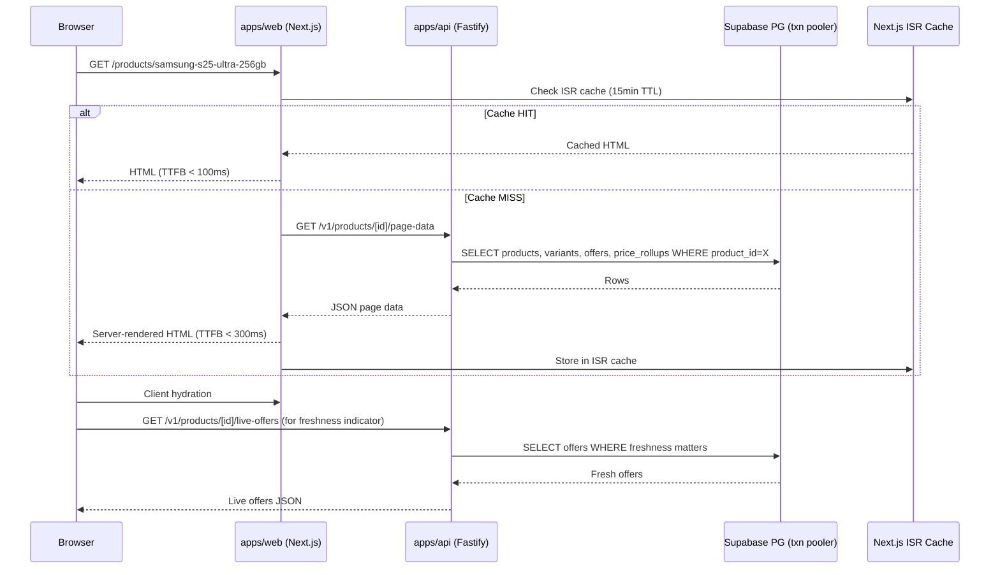
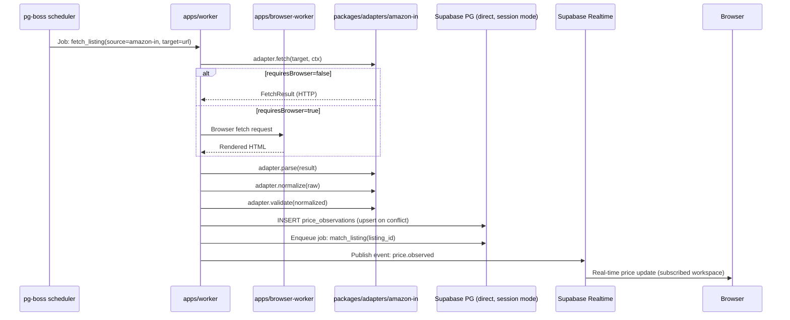

# 04 — Architecture

> Modular monolith, package boundaries, request/data flow, event model, queue model, scale triggers

---

## Architectural Thesis

A **modular monolith** deployed as multiple processes (web, API, worker, browser-worker, admin). Package boundaries enforce separation. A module becomes a separate service only when it hits a documented scale trigger. One PostgreSQL database (Supabase) until proven otherwise.

---

## Repository Structure

```
scrappy/
  apps/
    web/            Next.js 14 App Router (Compare + Intelligence + Extract UI + docs + marketing)
    api/            Fastify REST API (TypeScript, OpenAPI 3.1 from zod schemas)
    worker/         pg-boss worker process (jobs: fetch, parse, match, alert, notify, report, export, ai)
    browser-worker/ Playwright/Crawlee runner, isolated, resource-limited, sandboxed
    admin/          Internal ops console (separate deploy, allowlisted staff + MFA)
  packages/
    ui/             Design system (tokens, components, motion, charts)
    brand/          Logo SVGs, animated mark, favicons, OG templates
    db/             Supabase schema types, migration utilities, query helpers, tenancy helpers
    core/           Domain types, zod schemas, events, errors, units/currency normalization
    scraping/       Adapter contract, fetchers, renderers, validators, health
    adapters/       One folder per source (amazon-in, flipkart, croma-stub, reliance-stub)
    matching/       Entity resolution engine + evaluation harness
    pricing/        Price stats, deal score, anomaly detection
    ai/             Provider-agnostic AI layer, prompts, evals, caching
    config/         eslint, tsconfig, prettier, tailwind presets
  supabase/
    migrations/     Versioned SQL files (forward-only, expand/contract)
    seed.sql        Local dev seed data (synthetic, flagged is_synthetic=true)
    functions/      Supabase Edge Functions (lightweight triggers only)
    config.toml     Local stack configuration
  docs/             Architecture, ADRs, runbooks, API, security, brand
  fixtures/         Recorded HTML/JSON per source (committed, small, for offline tests)
  infra/            Docker Compose (Mailpit, MinIO for local override), deploy configs
```

---

## Package Dependency Rules

Enforced by ESLint import-boundaries plugin. CI fails on violations.

```
apps/* -> packages/*         (apps may depend on any package)
packages/* -> packages/*     (packages may NOT depend on apps)
packages/adapters -> packages/scraping + packages/core ONLY
packages/scraping -> packages/core ONLY
packages/matching -> packages/db + packages/core
packages/pricing  -> packages/db + packages/core
packages/ai       -> packages/core
packages/db       -> packages/core
```

---

## Process Architecture

```
                    ┌─────────────────────────────────────────┐
                    │           Supabase (managed PG)         │
                    │  postgres:5432 (session mode: workers)  │
                    │  supavisor:6543 (txn mode: api/web)     │
                    │  Realtime: websocket subscriptions       │
                    │  Storage: object store                   │
                    │  Auth: JWT sessions                      │
                    └─────────┬────────────┬───────────────────┘
                              │            │
              ┌───────────────┘            └──────────────────┐
              │                                               │
    ┌─────────▼───────────┐              ┌──────────────────────▼───┐
    │  apps/api           │              │  apps/worker              │
    │  Fastify REST       │◄─────────────│  pg-boss consumer         │
    │  Port 3001          │  Job enqueue │  Direct PG (session mode) │
    │  Txn pooler conn    │              │  Jobs: fetch, parse,      │
    │  Zod validation     │              │  match, alert, notify,    │
    │  OpenAPI 3.1        │              │  report, export, ai       │
    └─────────┬───────────┘              └──────────┬───────────────┘
              │                                     │
              │ HTTP                                │ launches
    ┌─────────▼───────────┐              ┌──────────▼───────────────┐
    │  apps/web           │              │  apps/browser-worker      │
    │  Next.js App Router │              │  Playwright + Crawlee     │
    │  SSR + ISR + RSC    │              │  Isolated, resource-capped│
    │  Port 3000          │              │  60s / 40 req / 300MB max │
    └─────────────────────┘              └──────────────────────────┘

    ┌─────────────────────┐
    │  apps/admin         │
    │  Internal ops       │
    │  Allowlisted + MFA  │
    │  Port 3002          │
    └─────────────────────┘
```

---

## Request Flow: Shopper Product Page Load



---

## Request Flow: Background Scraping Job



---

## Event Model

All domain events flow through a Postgres-backed event bus (initially using pg-boss jobs as the transport). Events are typed in `@scrappy/core/events`.

### Event Types

```typescript
// @scrappy/core/src/events.ts
type DomainEvent =
  | { type: "price.observed"; payload: PriceObservedPayload }
  | { type: "price.changed"; payload: PriceChangedPayload }
  | { type: "availability.changed"; payload: AvailabilityChangedPayload }
  | { type: "listing.matched"; payload: ListingMatchedPayload }
  | { type: "listing.match_needs_review"; payload: MatchNeedsReviewPayload }
  | { type: "alert.triggered"; payload: AlertTriggeredPayload }
  | { type: "run.completed"; payload: RunCompletedPayload }
  | { type: "run.failed"; payload: RunFailedPayload }
  | { type: "schema.drift_detected"; payload: SchemaDriftPayload }
  | { type: "source.circuit_opened"; payload: CircuitOpenedPayload }
  | { type: "usage.recorded"; payload: UsageRecordedPayload };
```

### Event Flow

```
price.observed -> price.changed? (compare with last observation)
              -> alert rule evaluator (check watch_items)
              -> notification fanout (dedupe, channel delivery)
              -> usage.recorded (metering)
              -> Realtime publish (live UI update)
```

---

## Queue Model

**Technology**: pg-boss (Postgres-based, direct connection, session mode port 5432)

**Why NOT transaction pooler**: pg-boss uses advisory locks and LISTEN/NOTIFY which require persistent session-mode connections. Supabase's transaction pooler (Supavisor port 6543) is incompatible. Workers connect directly to PG.

**Queue design**:

| Queue Name        | Priority | Concurrency | Retry     | Notes                            |
| ----------------- | -------- | ----------- | --------- | -------------------------------- |
| `fetch_http`      | normal   | 20          | 3 backoff | HTTP-first fetches               |
| `fetch_browser`   | normal   | 5           | 1         | Browser-required fetches         |
| `parse_listing`   | high     | 30          | 0         | No retry: alert on parse failure |
| `match_listing`   | normal   | 10          | 3         | Entity resolution                |
| `alert_evaluate`  | critical | 50          | 3         | Alert rule matching              |
| `notify_deliver`  | high     | 20          | 3         | Notification channel delivery    |
| `report_generate` | low      | 3           | 1         | Scheduled reports                |
| `export_run`      | low      | 5           | 1         | Data exports                     |
| `ai_adjudicate`   | normal   | 5           | 1         | AI match adjudication            |
| `usage_rollup`    | low      | 1           | 3         | Hourly usage aggregation         |

**Dead-letter**: Failed jobs after all retries move to `dlq_*` queues. Visible in admin. Ops can replay or discard.

**Scale trigger**: Migrate to BullMQ + Redis when queue throughput > ~200 jobs/s or lock contention visible in DB metrics.

---

## Scale Triggers (when to split a module)

Documented in `/docs/architecture/scale-triggers.md`:

| Component       | Split When                                         | Target Architecture         |
| --------------- | -------------------------------------------------- | --------------------------- |
| Queue (pg-boss) | > 200 jobs/s or lock contention                    | BullMQ + Redis              |
| Search (PG FTS) | p95 > 150ms or > 1M indexed products               | Meilisearch (self-hosted)   |
| Browser workers | Browser minutes > 30% infra cost or need autoscale | Dedicated fleet, autoscaled |
| Matching        | Matching CPU starves API or batch > 1h             | Separate service            |
| Read replicas   | DB CPU > 60% sustained or reporting hurts OLTP     | Supabase read replica       |
| Time-series     | observations > ~1B rows or rollup queries > 500ms  | Timescale or ClickHouse     |
| Supabase tier   | Pooler connections near limit                      | Upgrade compute size        |

---

## Tenancy Model

Every workspace-owned table has `workspace_id UUID NOT NULL` with FK to `workspaces`.

The `scoped()` helper in `@scrappy/db` is the ONLY way to query tenant tables:

```typescript
// packages/db/src/tenancy.ts
export function scoped(db: Database, workspaceId: string) {
  return {
    // Returns a query builder that automatically adds WHERE workspace_id = ?
    // A lint rule (custom eslint plugin) flags any direct query on tenant tables
    // that doesn't use scoped()
  };
}
```

**RLS is the last line of defense** (not the only one). Row Level Security is enabled with deny-by-default on every table. Policies are tested with cross-tenant attack tests in CI.

---

## Module Architecture (detailed)

### @scrappy/core

- Domain types (Product, Variant, Offer, Merchant, etc.)
- Zod schemas for every domain entity
- Error classes (AppError hierarchy)
- Unit/currency normalization (INR minor units, unit conversion)
- Event type definitions
- Env loader (zod-validated, fails fast)

### @scrappy/db

- Supabase-generated TypeScript types (from `supabase gen types`)
- Drizzle schema definitions (for complex query building)
- Migration utilities
- `scoped()` tenancy helper
- Query helpers for hot paths

### @scrappy/scraping

- Adapter contract (TypeScript interfaces)
- HTTP fetcher (undici, conditional requests, SSRF guard)
- Browser renderer (Playwright via Crawlee, pooled contexts)
- Rate limiter (per-host token bucket)
- robots.txt fetcher + enforcer
- Circuit breaker (per source)
- Schema drift detector
- Health aggregator

### @scrappy/adapters

- One folder per source
- Each folder: adapter.ts, fixtures/, README.md (legal notes), tests/
- Stubs initially; real implementations per phase

### @scrappy/matching

- Normalization pipeline (brand aliasing, tokenization)
- Candidate retrieval (identifier lookup, blocking keys, trigram, pgvector)
- Pairwise scoring (weighted features, evidence rows)
- Decision thresholds (tunable via config, not hardcoded)
- Benchmark harness (/bench directory)
- Human review queue interface

### @scrappy/pricing

- Price statistics computation (from rollups + observations)
- Deal score (transparent formula, component weights)
- Anomaly detection (robust z-score)
- Fake-discount detector (MRP inflation check)
- Buy-timing signal (Stage 2)

### @scrappy/ai

- Provider-agnostic interface (`AIProvider`)
- Gemini adapter (via `@google/generative-ai`)
- Fake/deterministic adapter (for local dev and testing)
- Prompt registry (versioned, content-hash cached)
- Cost tracker (per call, per day budget ceiling)
- Eval framework

---

## Local Development Stack

```yaml
# infra/docker-compose.yml (supplements supabase start)
services:
  mailpit:
    image: axllent/mailpit:latest
    ports: ["8025:8025", "1025:1025"] # Web UI + SMTP

  minio: # Only if overriding Supabase Storage locally
    image: minio/minio:latest
    ports: ["9000:9000", "9001:9001"]
    command: server /data --console-address :9001
```

**Primary local stack**: `supabase start` (provides PG, Auth, Storage, Realtime, Studio at localhost)

One command to boot everything:

```bash
pnpm dev
# Runs: supabase start, then all apps in turbo dev mode
```
