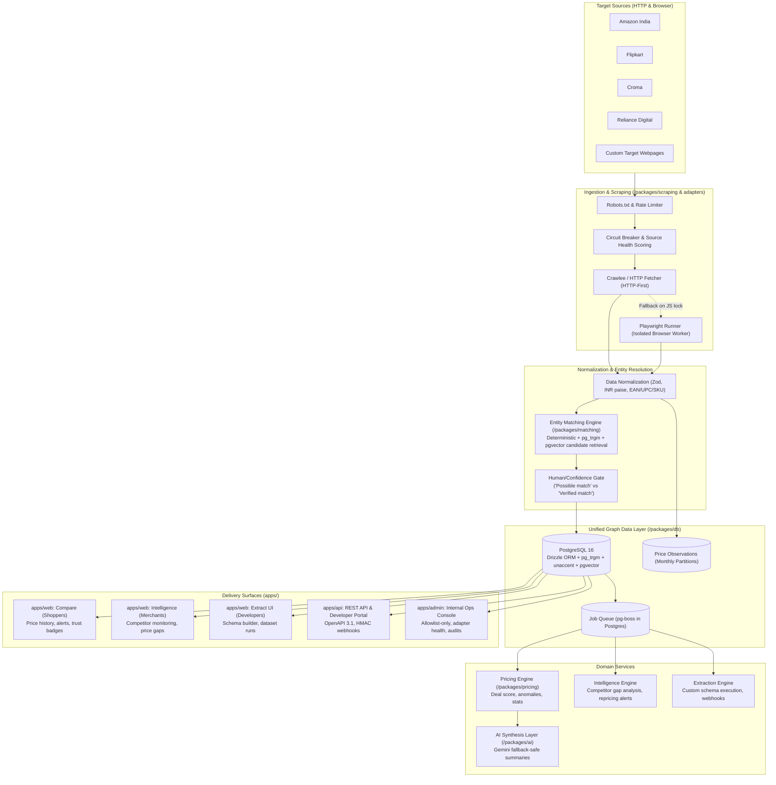

# Architecture Overview

> SCRAPPY architectural blueprint and data flow from raw web to multi-audience experiences.

## Thesis

Web data -> Source -> Extraction -> Normalization -> Entity resolution -> Product/Merchant/Offer graph -> Price history -> Intelligence -> Consumer, Business and Developer experiences. Compare, Intelligence and Extract are three views on ONE unified platform.

## Core Tenets

1. **Provenance First**: Every observation records `source`, `source_url`, `fetched_at`, `extraction_method`, and `confidence_score`.
2. **Conservative Entity Resolution**: Missed matches can be flagged later; false merges corrupt historical data permanently.
3. **Resilient Ingestion**: Failure of a single source adapter triggers circuit-breakers and isolated retries without affecting other targets or consumers.
4. **Tenant Isolation**: B2B workspaces and customer extractors have database-level row filtering enforced on all data queries.
