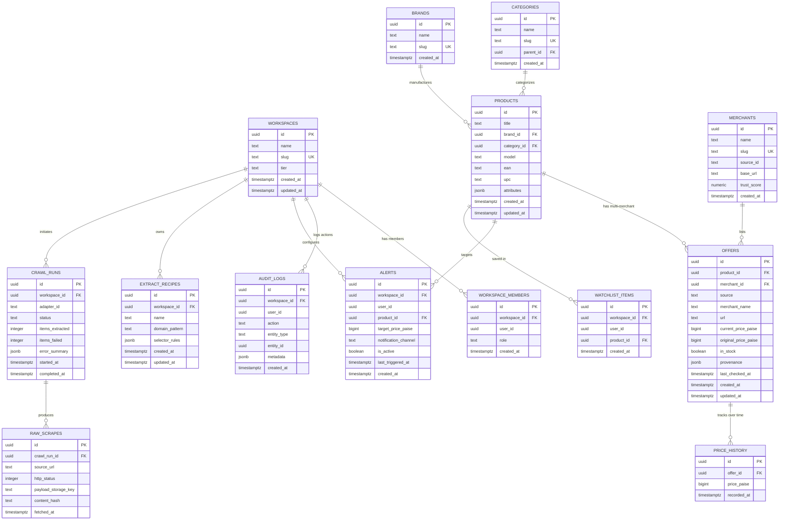

# Scrappy Entity Relationship Diagram (ERD)

> Comprehensive schema documentation for all catalog, offer, tenancy, and crawl tables.

## Security & Tenancy Invariants
- **Public Tables**: `categories`, `brands`, `merchants`, `products`, `offers`, `price_history`. Read-accessible anonymously, write-restricted to service-role background workers.
- **Tenant-Isolated Tables**: `workspaces`, `workspace_members`, `alerts`, `watchlist_items`, `extract_recipes`, `crawl_runs`, `raw_scrapes`, `audit_logs`. Enforced with PostgreSQL Row Level Security (RLS) on `workspace_id`.
